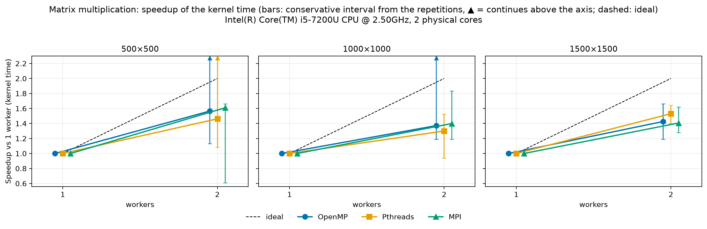
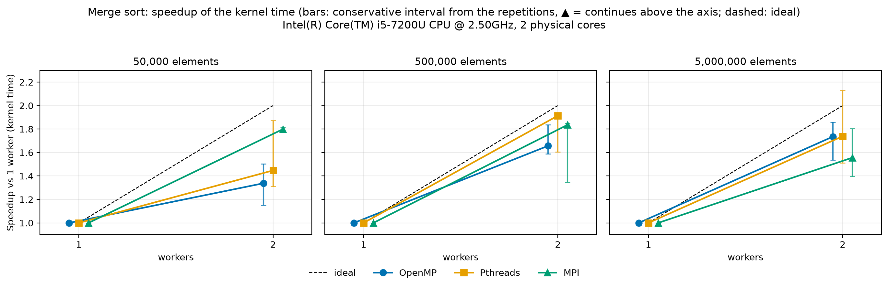
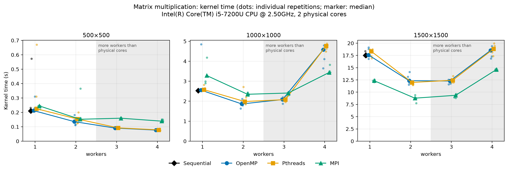
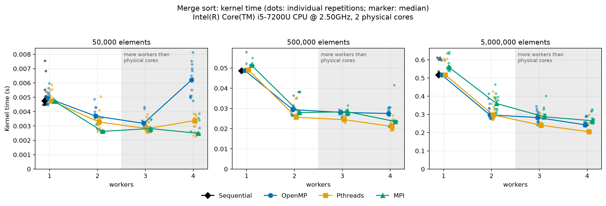

# Parallel Computing Benchmark: Merge Sort & Matrix Multiplication


[](https://github.com/Namra-5/parallel_sorting_and_matrix_benchmark/actions/workflows/benchmark-smoke.yml)

A comparative study of **four execution models** — Sequential, OpenMP, POSIX Threads (Pthreads) and MPI — on two classic
workloads: **Merge Sort** (memory-bound, O(n log n)) and **Matrix Multiplication** (compute-bound, O(n³)).

The project began as a course assignment ([report.pdf](./report.pdf), Operating Systems, NUST) and was then rebuilt around a
single rule: **a measurement counts only if the program exited cleanly and printed exactly the same answer as the
sequential program.** Everything here — the C implementations, the benchmark harness, the statistics, the tests and the CI —
is organised to make that rule automatic, so that scaling results are trustworthy and reproducible by anyone.

**At a glance**

- Four execution models × two workloads, every measured run validated against the sequential output.
- On a 2-core laptop, two workers speed up the computation by about 1.3–1.9× (kernel time); end-to-end speedups are at most about
  1.4× because reading and printing the text files is serial (see [Results](#results)).
- An audit of the original code found and fixed silent correctness defects (a wrongly sorted MPI result, an "OpenMP" sort that ran
  on one thread, a hanging Pthreads sort, failed MPI launches timed as results) and two flaws in the measurement protocol itself
  (see [Problems found and fixed](#problems-found-and-fixed)).

---

## Table of Contents

- [What is validated](#what-is-validated)
- [Execution models](#execution-models)
- [Project structure](#project-structure)
- [Prerequisites](#prerequisites)
- [Quick start](#quick-start)
- [Reproducing the scaling benchmark](#reproducing-the-scaling-benchmark)
- [Results](#results)
- [Measurement methodology](#measurement-methodology)
- [Problems found and fixed](#problems-found-and-fixed)
- [Limitations](#limitations)
- [Citation](#citation)
- [Tech stack](#tech-stack) · [Author](#author) · [Acknowledgments](#acknowledgments) · [License](#license)

---

## What is validated

| Guarantee | How it is enforced |
|---|---|
| Every parallel run is checked | `benchmark/run_benchmark.py` records the exit code and a SHA-256 of stdout for every run and compares it with the sequential output for the same input. Only `ok` runs enter any statistic. |
| Failed or hung launches cannot look fast | Non-zero exits, wrong output and timeouts get their own status and are excluded; the timeout kills the whole process tree. |
| Correct for awkward sizes | Regression tests build every binary and compare it with an independent Python oracle (empty input, fewer elements than threads, sizes not divisible by the rank count, non-square matrices, malformed files). |
| Scaling claims are honest | Configurations with more workers than physical cores are flagged `oversubscribed` and excluded from `scaling_valid`. |
| Reproducible | Seeded generators, input SHA-256 manifest, recorded hardware/compiler/MPI/git state, identical floating-point policy (`-ffp-contract=off`). |
| Memory safe | The non-MPI binaries are built and run under AddressSanitizer + UndefinedBehaviorSanitizer in CI (`make EXTRA_CFLAGS="-fsanitize=address,undefined"`); the MPI binaries were checked the same way during development. |

CI ([`benchmark-smoke.yml`](.github/workflows/benchmark-smoke.yml)) runs the unit tests, the regression tests, a smoke
benchmark and the sanitizer build on every pull request and every push to `main`.

---

## Execution models

| Model | Type | Memory | Implementation notes |
|---|---|---|---|
| Sequential | Baseline | Single thread | Reference for correctness *and* for every speedup |
| OpenMP | Shared memory | Threads | Matrix: `#pragma omp parallel for` over rows. Sort: **task-based** merge sort with a sequential cut-off |
| Pthreads | Shared memory | Threads | Explicit balanced partitioning; thread count from `BENCH_THREADS` (default: online CPUs) |
| MPI | Distributed memory | Processes | Matrix: broadcast of A and B, balanced row blocks, `MPI_Gatherv`. Sort: `MPI_Scatterv` → local sort → `MPI_Gatherv` → merge. Works for any rank count |

The four sorting binaries share **one** merge kernel (`merge_sort/src/msort.c`), so the comparison measures the
parallelisation strategy rather than four slightly different sort routines.

---

## Project structure

```
.
├── common/bench_common.h        # kernel timer + thread-count helper shared by all binaries
├── merge_sort/
│   ├── src/ array.c/.h  msort.c/.h  sequential.c  omp.c  thread2.c  mpi.c
│   ├── Makefile  random_array.py  Test-Script.sh  bin/  data/
├── matrix_multiplication/
│   ├── src/ matrix.c/.h  sequential.c  omp.c  thread2.c  mpi.c
│   ├── Makefile  random_float_matrix.py  Test-Script.sh  bin/  data/
├── benchmark/
│   ├── run_benchmark.py         # validated driver -> results/raw_runs.csv
│   ├── standardize.py           # raw runs -> results/benchmark_results.csv (speedup, efficiency)
│   ├── plot_results.py          # speedup figures from the results CSV
│   ├── results_table.py         # generates the README results block from the dataset (and checks it)
│   ├── tests/                   # unit + regression tests
│   ├── results/                 # validated dataset: raw runs, standardised table, environment, figures, dataset card
│   └── README_BENCHMARK.md      # dataset schema and interpretation guide
├── docs/ENGINEERING_NOTES.md    # defects found, evidence, fixes, residual risks
├── .github/workflows/benchmark-smoke.yml
└── report.pdf  ERRATA.md  CHANGELOG.md  CITATION.cff  NOTICE  LICENSE
```

---

## Prerequisites

- Linux, macOS or Windows via **WSL**
- `gcc` with OpenMP (libgomp ships with gcc; `libomp-dev` is only needed for clang), `make`
- `mpicc` / `mpirun` (Open MPI), `python3` ≥ 3.9 (tested with 3.12 and 3.13) with `pandas` (`matplotlib` for plots, `pytest` for tests)

```bash
sudo apt update && sudo apt install build-essential libopenmpi-dev openmpi-bin python3 python3-pip
python3 -m pip install -r benchmark/requirements.txt
```

---

## Quick start

```bash
python3 -m pytest benchmark/tests -q                              # unit + regression tests
python3 benchmark/run_benchmark.py --smoke --out-dir /tmp/smoke   # ~10 s end-to-end check
```

---

## Reproducing the scaling benchmark

```bash
python3 benchmark/run_benchmark.py --workload both \
    --matrix-sizes 500 1000 1500 --sort-sizes 50000 500000 5000000 \
    --reps 5 --sort-reps 15 --cooldown 20 --warmup \
    --notes "describe the machine: bare metal / WSL2 / VM, power mode, background load"
python3 benchmark/standardize.py        # -> benchmark/results/benchmark_results.csv
python3 benchmark/plot_results.py       # -> benchmark/results/*.png
```

`--workers` defaults to 1, 2, 4, … up to the physical core count; `--cooldown` pauses between repetitions, which helps on thermally limited laptops. Outputs (`raw_runs.csv`, `benchmark_results.csv`,
`hardware_environment.json`, `inputs_manifest.json`) are described in [benchmark/README_BENCHMARK.md](benchmark/README_BENCHMARK.md).
Select only rows with `scaling_valid == True` when making scaling claims.

---

## Results

**Setup.** Intel Core i5-7200U (2 physical cores, 4 hardware threads), 3.77 GiB RAM, WSL2 Ubuntu 24.04 on Windows,
gcc 13.3.0, Open MPI 4.1.6; laptop plugged in, best-performance power mode, idle. Code version `411d64e`. Provenance, files and
limits: the dataset card [`benchmark/results/README.md`](benchmark/results/README.md).

**Protocol.** For every workload and size: one untimed sequential reference run, then repetitions (5 for the matrices, 15 for
the cheaper sorts) of all configurations (sequential, and OpenMP / Pthreads / MPI with 1 to 4 workers). Inside each repetition
the order is shuffled with a fixed seed, an untimed warm-up precedes it and a 20 s cooldown separates repetitions. Values are
medians. *Kernel time* is measured inside the program (computation only); *wall time* is the whole process including
parsing and printing the text files and, for MPI, `mpirun`.

With 2 physical cores, only 1 → 2 workers is a valid scaling measurement. Runs with 3 and 4 workers (hyper-threads) are in the
dataset, flagged `oversubscribed`, and reported separately below.

<!-- results:start (generated by benchmark/results_table.py; do not edit by hand) -->

All 780 recorded runs exited cleanly and printed exactly the sequential program's output (78 configurations).

**Scaling from 1 to 2 workers.** Each model against its own one-worker run; efficiency = kernel speedup / 2; 'vs sequential' compares with the sequential program. Medians of the repetitions.

| Workload | Size | Model | Kernel speedup vs 1 worker (2 workers; conservative interval) | Efficiency | Kernel speedup vs sequential | Wall speedup vs 1 worker |
|---|---|---|---|---|---|---|
| Matrix multiplication | 500×500 | OpenMP | 1.57 (1.13–2.80) | 0.78 | 1.55 | 1.14 |
| Matrix multiplication | 500×500 | Pthreads | 1.46 (1.08–5.42) | 0.73 | 1.36 | 1.11 |
| Matrix multiplication | 500×500 | MPI | 1.61 (0.61–1.66) | 0.80 | 1.38 | 1.03 |
| Matrix multiplication | 1000×1000 | OpenMP | 1.37 (1.19–2.96) | 0.69 | 1.36 | 1.18 |
| Matrix multiplication | 1000×1000 | Pthreads | 1.30 (0.94–1.53) | 0.65 | 1.28 | 1.16 |
| Matrix multiplication | 1000×1000 | MPI | 1.40 (1.19–1.83) | 0.70 | 1.08 | 1.12 |
| Matrix multiplication | 1500×1500 | OpenMP | 1.43 (1.19–1.66) | 0.71 | 1.42 | 1.32 |
| Matrix multiplication | 1500×1500 | Pthreads | 1.53 (1.40–1.64) | 0.77 | 1.46 | 1.40 |
| Matrix multiplication | 1500×1500 | MPI | 1.41 (1.28–1.62) | 0.70 | 2.00 | 1.18 |
| Merge sort | 50,000 | OpenMP | 1.34 (1.15–1.50) | 0.67 | 1.29 | 1.00 |
| Merge sort | 50,000 | Pthreads | 1.45 (1.31–1.87) | 0.72 | 1.45 | 1.09 |
| Merge sort | 50,000 | MPI | 1.80 (1.78–1.81) | 0.90 | 1.81 | 0.99 |
| Merge sort | 500,000 | OpenMP | 1.66 (1.59–1.84) | 0.83 | 1.65 | 1.08 |
| Merge sort | 500,000 | Pthreads | 1.91 (1.60–1.92) | 0.96 | 1.90 | 1.14 |
| Merge sort | 500,000 | MPI | 1.84 (1.35–1.85) | 0.92 | 1.74 | 1.04 |
| Merge sort | 5,000,000 | OpenMP | 1.74 (1.54–1.86) | 0.87 | 1.74 | 1.10 |
| Merge sort | 5,000,000 | Pthreads | 1.74 (1.51–2.13) | 0.87 | 1.74 | 1.13 |
| Merge sort | 5,000,000 | MPI | 1.56 (1.40–1.80) | 0.78 | 1.44 | 1.01 |

**Key numbers**

- Kernel speedup with 2 workers over the same model with 1 worker: 1.30–1.91; no configuration reaches the ideal 2×.
- The conservative interval of the kernel speedup (order statistics of the repetitions; at least 87% coverage with 5 repetitions per side, 93% with 15) lies entirely above 1 in 16 of 18 configurations and entirely below the ideal 2× in 14 of 18.
- A one-worker OpenMP or Pthreads run takes 0.93–1.00 times the speed of the sequential program (kernel time, the same algorithm), which checks that the sequential baseline is not biased.
- The one-rank MPI matrix code is not equal in speed to the sequential program (500×500: 0.86, 1000×1000: 0.77, 1500×1500: 1.42; 1.00 = equal); it is a different implementation (flat arrays), so scaling is judged against each model's own one-worker run, and 'speedup vs sequential' mixes implementation and parallelism.
- Matrix multiplication: end-to-end (wall-time) speedup with 2 workers is only 1.03–1.40 because reading and printing the text files is serial.
- Merge sort: end-to-end (wall-time) speedup with 2 workers is only 0.99–1.14 because reading and printing the text files is serial.
- MPI wall time relative to the sequential program (2 ranks): 0.05–1.16 of its speed, because of `mpirun` start-up and output forwarding.
- Beyond the physical cores (flagged, not a scaling claim), matrix multiplication with 4 workers took 1.46–2.46 times as long as with 2 workers (the two largest matrix sizes, all three models).
- Beyond the physical cores (flagged, not a scaling claim), merge sort with 4 workers took 0.69–0.82 times as long as with 2 workers (the largest sort size, all three models).
- Run-to-run noise is right-skewed: across the 42 valid configurations the best repetition is typically 4% below the median, the slowest 20% above it (medians are reported; every repetition is visible in the kernel-time figures).
- Configurations with kernel CV above 0.25, where one slow repetition dominates: matrix multiplication 500×500 Sequential with 1 worker (CV 0.56); matrix multiplication 500×500 Pthreads with 1 worker (CV 0.59); matrix multiplication 500×500 MPI with 2 workers (CV 0.48); matrix multiplication 1000×1000 OpenMP with 1 worker (CV 0.34).

**Kernel time (median seconds) for every worker count.** Columns marked * exceed the 2 physical cores: they are in the dataset but flagged `oversubscribed` and are not scaling claims.

| Workload | Size | Model | 1 worker | 2 workers | 3 workers* | 4 workers* |
|---|---|---|---|---|---|---|
| Matrix multiplication | 500×500 | Sequential | 0.210 | – | – | – |
| Matrix multiplication | 500×500 | OpenMP | 0.212 | 0.136 | 0.0910 | 0.0769 |
| Matrix multiplication | 500×500 | Pthreads | 0.225 | 0.154 | 0.0924 | 0.0784 |
| Matrix multiplication | 500×500 | MPI | 0.245 | 0.152 | 0.159 | 0.139 |
| Matrix multiplication | 1000×1000 | Sequential | 2.53 | – | – | – |
| Matrix multiplication | 1000×1000 | OpenMP | 2.55 | 1.86 | 2.08 | 4.58 |
| Matrix multiplication | 1000×1000 | Pthreads | 2.58 | 1.98 | 2.08 | 4.77 |
| Matrix multiplication | 1000×1000 | MPI | 3.28 | 2.35 | 2.41 | 3.43 |
| Matrix multiplication | 1500×1500 | Sequential | 17.5 | – | – | – |
| Matrix multiplication | 1500×1500 | OpenMP | 17.6 | 12.3 | 12.3 | 18.5 |
| Matrix multiplication | 1500×1500 | Pthreads | 18.3 | 12.0 | 12.4 | 18.8 |
| Matrix multiplication | 1500×1500 | MPI | 12.3 | 8.77 | 9.36 | 14.6 |
| Merge sort | 50,000 | Sequential | 0.00475 | – | – | – |
| Merge sort | 50,000 | OpenMP | 0.00494 | 0.00369 | 0.00319 | 0.00621 |
| Merge sort | 50,000 | Pthreads | 0.00475 | 0.00328 | 0.00282 | 0.00338 |
| Merge sort | 50,000 | MPI | 0.00472 | 0.00263 | 0.00282 | 0.00249 |
| Merge sort | 500,000 | Sequential | 0.0487 | – | – | – |
| Merge sort | 500,000 | OpenMP | 0.0487 | 0.0294 | 0.0281 | 0.0275 |
| Merge sort | 500,000 | Pthreads | 0.0491 | 0.0256 | 0.0245 | 0.0211 |
| Merge sort | 500,000 | MPI | 0.0514 | 0.0280 | 0.0283 | 0.0235 |
| Merge sort | 5,000,000 | Sequential | 0.517 | – | – | – |
| Merge sort | 5,000,000 | OpenMP | 0.516 | 0.298 | 0.283 | 0.243 |
| Merge sort | 5,000,000 | Pthreads | 0.517 | 0.297 | 0.241 | 0.205 |
| Merge sort | 5,000,000 | MPI | 0.560 | 0.360 | 0.287 | 0.266 |

<!-- results:end -->






In the last two figures every dot is one repetition and the marker is the median; the shaded region has more workers than
physical cores. Wall-time speedup figures and the 1–2 worker kernel-time figures are in `benchmark/results/`.

**Reading the results**

- The second core speeds up the computation for every model and size, but never ideally; which model scales best changes with
  workload and size, and the differences are modest compared with the run-to-run spread, so no ranking is claimed.
- Merge sort stays below the ideal partly by design: the final merge is serial (an Amdahl limit).
- End-to-end gains are far smaller than kernel gains because parsing and printing the text files is serial, and MPI adds launcher
  cost. Use kernel time to compare algorithms and wall time to judge end-to-end use.
- Beyond the physical cores the picture splits: for the 500,000- and 5,000,000-element sorts all three models were faster with 4
  workers than with 2 (at 50,000 elements only MPI was); the 500×500 matrix still gained for OpenMP and Pthreads; the larger
  matrices gained nothing from a third worker and slowed down clearly with a fourth. This is consistent with hyper-threading
  helping some access patterns and hurting others, but the cause was not investigated (for example with hardware counters).

**What the data does not show:** scaling beyond two physical cores, behaviour on other CPUs, or MPI across nodes. It is one
machine under WSL2; the raw runs, the standardised table and the environment record are provided so the measurement can be
repeated elsewhere.

---

## Measurement methodology

- **Two times per run.** `wall_s` is the whole process (includes `mpirun` start-up, parsing the text input and printing).
  `kernel_s` is measured *inside* the program (`BENCH_TIMING=1`) and covers computation only (for MPI also
  scatter/gather/merge). Input parsing is serial, so `wall_s` understates achievable speedup (Amdahl's law); `kernel_s` is
  the scaling signal.
- **Uncertainty.** Medians are accompanied by the min–max range, the coefficient of variation and a conservative, distribution-free interval for the kernel speedup (order statistics of the repetitions, no random numbers); with 5 repetitions per matrix configuration these intervals are wide, and drift between repetitions can make them optimistic.
- **Speedup / efficiency.** `S_N = T_seq / T_N` against the true sequential binary on the same workload and size;
  `E_N = S_N / N`. `speedup_vs_1worker` uses the same model with one worker. Medians over valid repetitions.
- **Run order and warm-up.** Repetitions are the outer loop and the order of the configurations inside each repetition is shuffled (seeded, recorded as `order`), so slow drift (thermal, background load) and the slower first run after an idle pause do not systematically favour any model. An untimed sequential reference run per input defines the expected output hash; optional `--warmup` and `--cooldown` further stabilise laptops.
- **Compiler.** `-O2 -Wall -std=gnu99 -g -fopenmp -ffp-contract=off` for every model; no model-specific tuning.
- **Known simplification.** The matrix kernel keeps the textbook `i-j-k` loop order (inherited from the upstream
  scaffold), which is cache-unfriendly; absolute times are therefore much slower than a tuned BLAS. All models share it,
  so relative comparisons remain valid, but the figures are not a statement about peak hardware performance.

---

## Problems found and fixed

While preparing the project for publication as a reproducible dataset, a code audit showed that parts of the original
measurements could not be trusted. MPI runs that failed to launch had been timed as if they were results, the "OpenMP"
merge sort ran on a single thread, and the MPI merge sort silently returned wrongly sorted arrays for some input sizes.
These defects were fixed, pinned down by regression tests, and the measurement pipeline was rebuilt so that a run only
counts if it exits cleanly and reproduces the sequential output. The statements of the original report affected by this are
listed in [ERRATA.md](./ERRATA.md); full evidence and residual risks are in [docs/ENGINEERING_NOTES.md](docs/ENGINEERING_NOTES.md).

| # | Problem (evidence) | Fix |
|---|---|---|
| 1 | **Failed MPI launches were timed as results.** With fewer slots than processes, `mpirun` exits in ≈0.06 s with "not enough slots"; the old script discarded that error. | Harness checks exit status and output hash; scripts print `FAILED`; oversubscribed runs get the right launch flag and are flagged. |
| 2 | `merge_sort/src/mpi.c` returned a **wrongly sorted array with exit code 0** whenever n was not divisible by the rank count. | `MPI_Scatterv`/`Gatherv`; regression tests. |
| 3 | The "OpenMP" merge sort **ran on one thread**: nested `parallel sections` are inactive under the default `max-active-levels=1` (verified by instrumentation). | Task-based sort; a test asserts that several threads execute work. |
| 4 | `merge_sort/src/thread2.c` **hung forever** when elements < cores. | Thread count capped at n, balanced split. |
| 5 | The MPI matrix code aborted unless rows % ranks == 0. | Row distribution for any rank count. |
| 6 | Parsers accepted bad input silently: a non-integer token truncated the array, a missing final newline dropped the last matrix row, a truncated matrix became zeros. | Explicit errors on stderr and a non-zero exit. |
| 7 | A root-level `.gitkeep` contained `.gitignore` rules and so ignored nothing. | A real `.gitignore` (data, binaries). |
| 8 | `<malloc.h>` does not exist on macOS. | Removed. |
| 9 | Four duplicated `merge()` copies. | One shared kernel. |
| 10 | A CI run on a newer Open MPI (PRRTE launcher, whose `--version` never says "Open MPI") exposed fragile launcher detection: no oversubscribe flag was added. | Launch flags are now **probed** by test launches, not inferred from version text; covered by tests with fake launchers. |
| 11 | The first full measurement run showed wall times on a 50 ms grid: the harness waited with `Popen.wait(timeout=…)`, which polls in steps of up to 50 ms, inflating every wall time by 0–50 ms (a 0.17 s process read as 0.216 s). `kernel_s` was unaffected. | Blocking waiter thread; regression test. |
| 12 | With a fixed run order the sequential program was always the first run after the cooldown. In an earlier run its kernel time at 50,000 elements was 63% above the identical one-thread OpenMP run that followed it, while there was no such effect from 50 ms upwards: the first run after an idle pause is slower for millisecond-scale work. | Seeded random order inside every repetition (recorded as `order`), an untimed reference run and optional warm-up; the repeated measurement shows the sequential and one-worker kernels agreeing. |

---

## Limitations

- Results depend on the machine; always read `hardware_environment.json` next to a result file.
- Wall time includes serial text I/O and (for MPI) process launch; kernel time excludes input parsing and output printing.
- MPI runs are single-node (shared-memory transport): they measure process-level parallelism, not network scaling.
- Sorting uses a serial final merge (an inherent Amdahl limit); matrix MPI broadcasts full A and B to every rank.
- Hyper-threads are not counted as cores: more workers than physical cores is reported as oversubscribed. The published dataset comes from a 2-core machine, so valid scaling covers 1 to 2 workers only.
- Tested on Ubuntu 24.04 under WSL2 (Open MPI 4.1.6) and on GitHub's Ubuntu runner (PRRTE-based Open MPI launcher). macOS, MPICH and native Windows have not been tested.

---

## Citation

If you use this software or its data, please cite it using [CITATION.cff](CITATION.cff) (GitHub's "Cite this repository"
button). A DOI is issued with each tagged release through Zenodo.

---

## Tech stack

`C (gnu99)` · `OpenMP` · `POSIX Threads` · `MPI (Open MPI)` · `Python 3` (pandas, matplotlib, pytest) · `Bash` · `GNU Make` · `GitHub Actions`

---

## Author

**Namra Basharat** — BS Bioinformatics, National University of Sciences and Technology (NUST), School of Interdisciplinary
Engineering & Sciences. Course: Operating Systems.

## Acknowledgments

The matrix-multiplication scaffold (`matrix.c/.h`, the original per-model programs, `Makefile`, `Test-Script.sh`,
`random_float_matrix.py`) is adapted from [mperlet/matrix_multiplication](https://github.com/mperlet/matrix_multiplication)
(MIT, © 2022 Mathias Perlet; generator by Philipp Böhm). Modifications are listed in [NOTICE](./NOTICE) and
[CHANGELOG.md](./CHANGELOG.md). The merge-sort programs, the benchmark tooling, tests and analysis are original work.

## License

Code: [MIT](./LICENSE), with the third-party notice in [NOTICE](./NOTICE). Data: the files in [`benchmark/results/`](benchmark/results/) are released under CC BY 4.0 (see the dataset card there).
