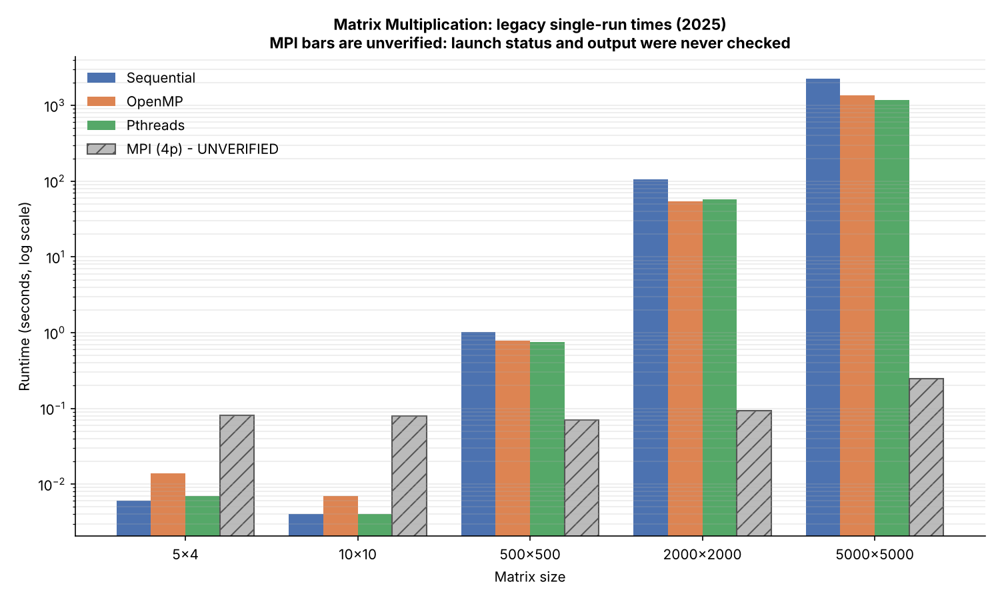
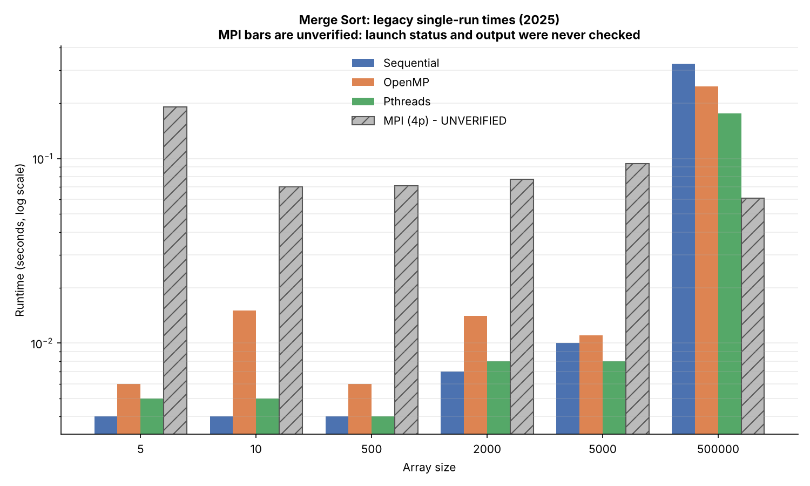

# Parallel Computing Benchmark: Merge Sort & Matrix Multiplication


A comparative study of **four execution models** — Sequential, OpenMP, POSIX Threads (Pthreads) and MPI — on two classic
workloads: **Merge Sort** (memory-bound, O(n log n)) and **Matrix Multiplication** (compute-bound, O(n³)).

The repository started as a course assignment ([report.pdf](./report.pdf), Operating Systems, NUST). It has since been
audited and rebuilt around one principle: **a number is only a result if the program that produced it finished
successfully and printed the same answer as the sequential reference.** The audit found, and this repository now fixes
and tests for, several defects that had silently invalidated parts of the original measurements (see
[Audit findings](#audit-findings-and-what-changed)).

---

## Table of Contents

- [What is validated](#what-is-validated)
- [Execution models](#execution-models)
- [Project structure](#project-structure)
- [Prerequisites](#prerequisites)
- [Quick start](#quick-start)
- [Reproducing the scaling benchmark](#reproducing-the-scaling-benchmark)
- [Measurement methodology](#measurement-methodology)
- [Audit findings and what changed](#audit-findings-and-what-changed)
- [Legacy Results (2025, single run, unvalidated)](#legacy-results-2025-single-run-unvalidated)
- [Limitations](#limitations)
- [Tech stack](#tech-stack)
- [Author](#author) · [Acknowledgments](#acknowledgments) · [License](#license)

---

## What is validated

| Guarantee | How it is enforced |
|---|---|
| Every parallel run is checked | `benchmark/run_benchmark.py` records the exit code and a SHA-256 of stdout for every run and compares it with the sequential output for the same input. Only `ok` runs enter any statistic. |
| Failed or hung launches cannot look fast | Non-zero exits, wrong output and timeouts get their own status and are excluded; the timeout kills the whole process tree. |
| Correct for awkward sizes | Regression tests build every binary and compare it with an independent Python oracle (empty input, fewer elements than threads, sizes not divisible by the rank count, non-square matrices, malformed files). |
| Scaling claims are honest | Configurations with more workers than physical cores are flagged `oversubscribed` and excluded from `scaling_valid`. |
| Reproducible | Seeded generators, input SHA-256 manifest, recorded hardware/compiler/MPI/git state, identical floating-point policy (`-ffp-contract=off`). |
| Memory safe | The test suite was additionally run under AddressSanitizer + UndefinedBehaviorSanitizer (`make EXTRA_CFLAGS="-fsanitize=address,undefined"`). |

CI (`.github/workflows/benchmark-smoke.yml`) runs the unit tests, the regression tests and a smoke benchmark on every push.

---

## Execution models

| Model | Type | Memory | Implementation notes |
|---|---|---|---|
| Sequential | Baseline | Single thread | Reference for correctness *and* for every speedup |
| OpenMP | Shared memory | Threads | Matrix: `#pragma omp parallel for` over rows. Sort: **task-based** merge sort with a sequential cut-off |
| Pthreads | Shared memory | Threads | Explicit balanced partitioning; thread count from `BENCH_THREADS` (default: online CPUs) |
| MPI | Distributed memory | Processes | Matrix: broadcast of A and B, row blocks, `MPI_Gatherv`. Sort: `MPI_Scatterv` → local sort → `MPI_Gatherv` → merge. Works for any rank count |

The four sorting binaries share **one** merge kernel (`merge_sort/src/msort.c`), so the comparison measures the
parallelisation strategy rather than four slightly different sort routines.

---

## Project structure

```
.
├── common/bench_common.h        # kernel timer + thread-count helper shared by all binaries
├── merge_sort/
│   ├── src/ array.c/.h  msort.c/.h  sequential.c  omp.c  thread2.c  mpi.c
│   ├── Makefile  random_array.py  Test-Script.sh  bin/  data/
├── matrix_multiplication/
│   ├── src/ matrix.c/.h  sequential.c  omp.c  thread2.c  mpi.c
│   ├── Makefile  random_float_matrix.py  Test-Script.sh  bin/  data/
├── benchmark/
│   ├── run_benchmark.py         # validated driver -> results/raw_runs.csv
│   ├── standardize.py           # raw runs -> results/benchmark_results.csv (speedup, efficiency)
│   ├── plot_results.py          # figures from the CSVs
│   ├── legacy_extract.py        # legacy README tables -> legacy_single_run_results.csv
│   ├── tests/                   # unit + regression tests
│   └── README_BENCHMARK.md      # dataset schema and interpretation guide
├── .github/workflows/benchmark-smoke.yml
├── docs/AUDIT_REPORT.md          # full audit: findings, evidence, residual risks
├── assets/  report.pdf  ERRATA.md  CHANGELOG.md  CITATION.cff  NOTICE  LICENSE
```

---

## Prerequisites

- Linux, macOS or Windows via **WSL**
- `gcc` with OpenMP (libgomp ships with gcc; `libomp-dev` is only needed for clang), `make`
- `mpicc` / `mpirun` (OpenMPI or MPICH), `python3` ≥ 3.9 (tested with 3.12 and 3.13) with `pandas` (`matplotlib` for plots, `pytest` for tests)

```bash
sudo apt update && sudo apt install build-essential libopenmpi-dev openmpi-bin python3 python3-pip
python3 -m pip install -r benchmark/requirements.txt
```

macOS: Apple's `gcc` is clang without OpenMP — `brew install gcc open-mpi`, then `make CC=gcc-14` in each workload folder.

---

## Quick start

```bash
python3 -m pytest benchmark/tests -q                         # unit + regression tests
python3 benchmark/run_benchmark.py --smoke --out-dir /tmp/smoke   # ~10 s end-to-end check
```

---

## Reproducing the scaling benchmark

```bash
python3 benchmark/run_benchmark.py --workload both \
    --matrix-sizes 500 1000 2000 --sort-sizes 50000 500000 5000000 \
    --reps 5 --notes "bare metal, Ubuntu 24.04, performance governor, no other load"
python3 benchmark/standardize.py        # -> benchmark/results/benchmark_results.csv
python3 benchmark/plot_results.py       # -> benchmark/results/*.png
```

`--workers` defaults to 1, 2, 4, … up to the physical core count. Outputs (`raw_runs.csv`, `benchmark_results.csv`,
`hardware_environment.json`, `inputs_manifest.json`) are described in [benchmark/README_BENCHMARK.md](benchmark/README_BENCHMARK.md).
Select only rows with `scaling_valid == True` when making scaling claims.

---

## Measurement methodology

- **Two times per run.** `wall_s` is the whole process (includes `mpirun` start-up, parsing the text input and printing).
  `kernel_s` is measured *inside* the program (`BENCH_TIMING=1`) and covers computation only (for MPI also
  scatter/gather/merge). Input parsing is serial, so `wall_s` understates achievable speedup (Amdahl); `kernel_s` is the
  scaling signal.
- **Speedup / efficiency.** `S_N = T_seq / T_N` against the true sequential binary on the same workload and size;
  `E_N = S_N / N`. `speedup_vs_1worker` uses the same model with one worker. Medians over valid repetitions.
- **Run order.** Repetitions are the outer loop so slow drift (thermal, background load) affects all models alike.
- **Compiler.** `-O2 -Wall -std=gnu99 -g -fopenmp -ffp-contract=off` for every model; no model-specific tuning.
- **Known simplification.** The matrix kernel keeps the textbook `i-j-k` loop order (inherited from the upstream
  scaffold), which is cache-unfriendly; absolute times are therefore much slower than a tuned BLAS. All models share it,
  so relative comparisons remain valid, but the figures are not a statement about peak hardware performance.

---

## Audit findings and what changed

| # | Finding (evidence) | Fix |
|---|---|---|
| 1 | **MPI timings in the original tables were not valid.** On a machine with fewer slots than processes, `mpirun -np 4` exits with "not enough slots" after ≈0.06 s (reproduced). `Test-Script.sh` discarded that error and timed it. The original MPI numbers (0.061–0.247 s, up to 9 202× "speedup" on 4 processes) match that signature. | Harness checks exit status + output hash; scripts print `FAILED`; OpenMPI gets `--oversubscribe` when needed and the row is flagged. |
| 2 | `merge_sort/src/mpi.c` returned a **wrongly sorted array with exit code 0** whenever n was not divisible by the rank count (reproduced for e.g. n=11, np=2,3,4,7). | `MPI_Scatterv`/`Gatherv`; regression tests. |
| 3 | The "OpenMP" merge sort **ran on one thread**: nested `parallel sections` are inactive under the default `max-active-levels=1` (team size 1, verified by instrumenting). | Task-based sort; test asserts several threads execute leaf sorts. |
| 4 | `merge_sort/src/thread2.c` **hung forever** when elements < cores (zero-size chunks; reproduced with 8 threads for n = 1, 2, 3, 5, 7). | Thread count capped at n, balanced split. |
| 5 | MPI matrix code aborted unless rows % ranks == 0. | Row distribution for any rank count. |
| 6 | Parsers silently accepted bad input: a non-integer token truncated the array; a matrix without final newline lost its last row; a truncated matrix became zeros. | Explicit errors on stderr, non-zero exit. |
| 7 | The driver's timeout never fired for a silent hang (blocking `read`). | Reader threads + process-group kill; regression test. |
| 8 | Root-level `.gitkeep` contained `.gitignore` rules and so ignored nothing. | Replaced by a real `.gitignore` (data files, binaries, results). |
| 9 | Portability: `<malloc.h>` does not exist on macOS; OpenMPI-only flags were passed unconditionally. | Removed; MPI launch flags are found by probing the installed `mpirun` (the spelling differs between Open MPI 4, Open MPI 5/PRRTE and MPICH). |
| 10 | Four duplicated `merge()` copies. | One shared kernel. |

Statements in the original [report.pdf](./report.pdf) that these findings affect are listed in [ERRATA.md](./ERRATA.md).
The PDF itself is kept unchanged as the historical submission.

---

## Legacy Results (2025, single run, unvalidated)

> **Read before using these numbers.** They are the original single-run `time` measurements. The **MPI columns (†) are
> unverified**: launch status and output were never checked, and several values are physically impossible for 4
> processes. They are kept only for provenance, are flagged in
> [`benchmark/legacy_single_run_results.csv`](benchmark/legacy_single_run_results.csv), and must not be cited as MPI
> performance. OpenMP/Pthreads/Sequential cells come from a machine whose core count was not recorded, and the OpenMP
> merge-sort cells were very likely produced by the effectively serial implementation described in finding 3 (the
> original environment variables were not recorded). Use the validated harness above
> for any claim.

### Matrix Multiplication



| Size | Sequential | OpenMP | Pthreads | MPI (4p) † |
|---|---|---|---|---|
| 5×4 | 0.006s | 0.014s | 0.007s | 0.081s† |
| 10×10 | 0.004s | 0.007s | 0.004s | 0.079s† |
| 500×500 | 1.011s | 0.785s | 0.758s | 0.071s† |
| 2000×2000 | 1m 46.573s | 54.399s | 57.713s | 0.094s† |
| 5000×5000 | 37m 52.786s | 22m 48.886s | 19m 49.032s | 0.247s† |

### Merge Sort



| Array size | Sequential | OpenMP | Pthreads | MPI (4p) † |
|---|---|---|---|---|
| 5 | 0.004s | 0.006s | 0.005s | 0.190s† |
| 10 | 0.004s | 0.015s | 0.005s | 0.070s† |
| 500 | 0.004s | 0.006s | 0.004s | 0.071s† |
| 2000 | 0.007s | 0.014s | 0.008s | 0.077s† |
| 5000 | 0.010s | 0.011s | 0.008s | 0.094s† |
| 500000 | 0.327s | 0.246s | 0.176s | 0.061s† |

What the legacy data *can* support: at small sizes the parallel models are slower than sequential (start-up cost
dominates), and Pthreads/OpenMP matrix multiplication was roughly 1.8–2.0× (2000²) and 1.7–1.9× (5000²) faster than
sequential on that machine. It cannot support any statement about MPI scaling.

---

## Limitations

- Results depend on the machine; always read `hardware_environment.json` next to a result file.
- Wall time includes serial text I/O and (for MPI) process launch; kernel time excludes input parsing and output printing.
- MPI runs are single-node (shared memory transport); this measures process-level parallelism, not network scaling.
- Sorting uses a serial final merge (inherent Amdahl limit); matrix MPI broadcasts full A and B to every rank.
- Hyper-threads are not counted as cores: more workers than physical cores is reported as oversubscribed.

---

## Tech stack

`C (gnu99)` · `OpenMP` · `POSIX Threads` · `MPI (OpenMPI / MPICH)` · `Python 3` (pandas, matplotlib, pytest) · `Bash` · `GNU Make` · `GitHub Actions`

---

## Author

**Namra Basharat** — BS Bioinformatics, National University of Sciences and Technology (NUST), School of Interdisciplinary
Engineering & Sciences. Course: Operating Systems.

## Acknowledgments

The matrix-multiplication scaffold (`matrix.c/.h`, the original per-model programs, `Makefile`, `Test-Script.sh`,
`random_float_matrix.py`) is adapted from [mperlet/matrix_multiplication](https://github.com/mperlet/matrix_multiplication)
(MIT, © 2022 Mathias Perlet; generator by Philipp Böhm). Modifications are listed in [NOTICE](./NOTICE) and
[CHANGELOG.md](./CHANGELOG.md). The merge-sort programs, the benchmark tooling, tests and analysis are original work.

## License

[MIT](./LICENSE) — third-party notice in [NOTICE](./NOTICE).
